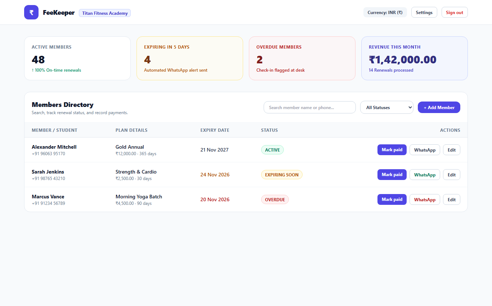
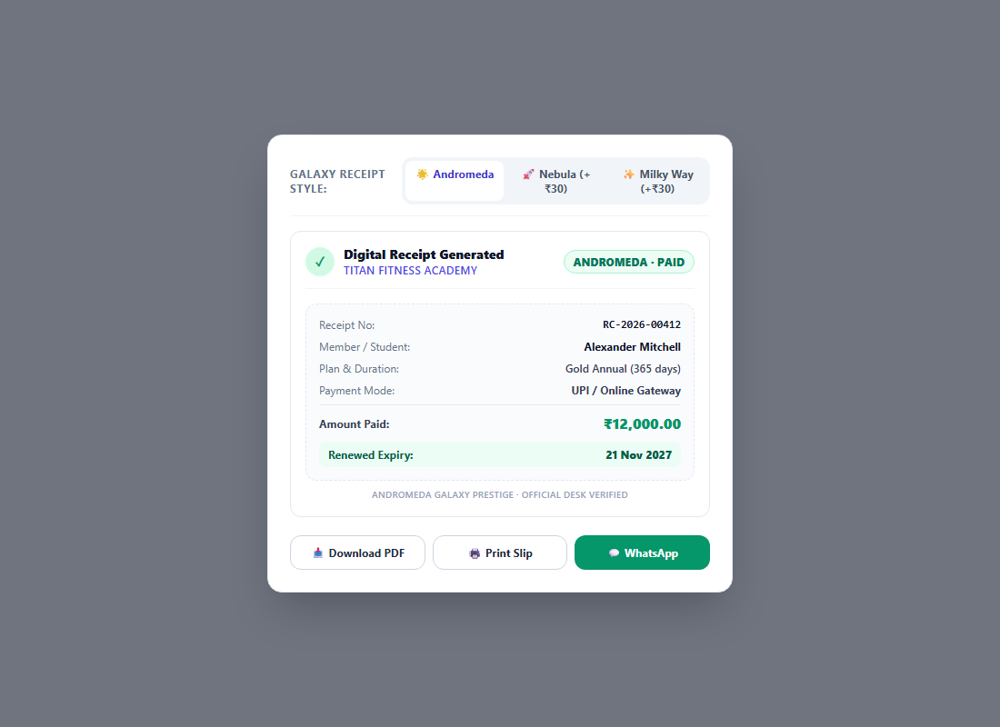

# FeeKeeper (Powered by Zovak) — Client User Manual & Operating Guide

Welcome to **FeeKeeper**, the next-generation membership and fee management platform engineered for gym owners, martial arts dojos, fitness studios, yoga centers, and coaching academies.

This manual provides step-by-step visual instructions for front-desk staff, administrators, and business owners on how to use every feature in the platform.

---

## Table of Contents
1. [Getting Started & Registration](#1-getting-started--registration)
2. [Dashboard Overview](#2-dashboard-overview)
3. [Member Management & Directory](#3-member-management--directory)
4. [Collecting Fees & Recording Payments ("Mark Paid")](#4-collecting-fees--recording-payments-mark-paid)
5. [Galaxy Digital Receipts (3 Cosmic Themes)](#5-galaxy-digital-receipts-3-cosmic-themes)
6. [Receipt Distribution: PDF, Print & WhatsApp](#6-receipt-distribution-pdf-print--whatsapp)
7. [Automated WhatsApp Notifications & Reminders](#7-automated-whatsapp-notifications--reminders)
8. [Promotions & Holiday Discount Offers](#8-promotions--holiday-discount-offers)
9. [Business Settings & Multi-Currency Configuration](#9-business-settings--multi-currency-configuration)
10. [Frequently Asked Questions & Troubleshooting](#10-frequently-asked-questions--troubleshooting)

---

## 1. Getting Started & Registration

### 1.1 Creating Your Account (Protected by Secret Registration Key)
To prevent unauthorized sign-ups and spam, FeeKeeper requires an authorized **Registration Secret Key**:
1. Open your browser and navigate to `/register`.
2. Enter your business details:
   - **Business Name**: Your institute or gym name (e.g., *Titan Fitness Academy*).
   - **Owner Name**: Name of primary proprietor/manager.
   - **Mobile Number**: 10-digit Indian mobile number (e.g., `9606395170`), optionally prefixed with `+91`.
   - **UPI ID (Optional)**: Your business VPA (e.g., `titanfitness@okaxis` or `paytmqr@icici`) so members can pay you directly.
   - **Email Address**: Your admin email used for sign-in.
   - **Password**: Secure password (8 to 72 characters).
   - **Registration Secret Key**: Enter your authorized access key (e.g., `zovak2026`).
     - *Don't have a key?* Click the **Contact Admin on WhatsApp (+91 96063 95170)** link right below the input to request your key directly from the administrator.
3. Click **Create account**. You are immediately authenticated and directed to your private dashboard.


*Figure 1: Fast self-service business onboarding with Secret Registration Key verification & WhatsApp admin support link.*

---

## 2. Dashboard Overview

The dashboard gives an immediate bird's-eye view of your center's key metrics:
- **Active Members**: Total students/members with valid, active memberships.
- **Expiring Soon (5 Days)**: Members whose plans expire within the next 5 days.
- **Overdue**: Members whose plans have elapsed without a renewal payment.
- **Revenue This Month**: Total membership fees collected during the current calendar month in your configured currency.


*Figure 2: Real-time metrics ribbon and searchable members directory with color-coded status badges.*

---

## 3. Member Management & Directory

### 3.1 Adding a New Member
1. Click the **+ Add Member** button on the top right of the dashboard.
2. Fill in the member profile details:
   - **Full Name**: Member's complete name.
   - **Mobile Number**: Primary WhatsApp-enabled mobile number.
   - **Plan Name**: Descriptive name (e.g., *Gold Annual*, *Strength & Cardio Quarterly*, *Evening Batch*).
   - **Plan Amount**: Price of the membership (e.g., `12000.00`).
   - **Duration in Days**: Length of membership (e.g., `30` for 1 month, `90` for quarterly, `180` for half-yearly, `365` for 1 year).
   - **Join Date**: Membership start date (defaults to today).
3. Click **Save Member**.
   - *Note*: FeeKeeper automatically computes the **Expiry Date** as `Join Date + Plan Duration Days`.

### 3.2 Member Status Indicators
Each member displays a color-coded status badge:
- 🟢 **ACTIVE**: Plan is currently valid and unexpired.
- 🟡 **EXPIRING SOON**: Plan expires in 5 days or fewer. Needs renewal reminder.
- 🔴 **OVERDUE**: Plan expired. Check-in access should be flagged until renewed.

### 3.3 Searching and Filtering
- **Search Bar**: Type any part of a member's name or mobile number for real-time search.
- **Status Filter**: Filter list by `ALL`, `ACTIVE`, `EXPIRING_SOON`, or `OVERDUE`.
- **Pagination**: Use **Previous** and **Next** buttons to navigate through members.

### 3.4 Editing or Deleting a Member
- Click **Edit** on any row/card to update plan name, amount, duration, or contact details.
- Click **Delete** to safely deactivate a member profile (soft-delete preserves audit integrity).

---

## 4. Collecting Fees & Recording Payments ("Mark Paid")

FeeKeeper features high-speed, tamper-proof payment recording equipped with **database-level pessimistic locking and idempotency protection**. Even if staff double-clicks in a rush, duplicate receipts or charges can never occur.

### Step-by-Step Payment Recording:
1. Locate the member on the dashboard and click the indigo **Mark paid** button.
2. In the payment dialog:
   - **Amount Paid**: Pre-filled with member's plan amount. You can edit if partial or discounted.
   - **Choose an Active Offer (Optional)**: Select an active seasonal promo code. Click **Preview offer** to verify the discount before applying.
   - **Payment Mode**: Select **UPI** (Online/QR) or **Cash** (Desk counter).
3. Click **Confirm payment**.
4. The system automatically:
   - Extends the member's expiry date by the plan duration.
   - Updates member status to **ACTIVE**.
   - Increments your month's collected revenue.
   - Generates a sequential **Receipt Number** (e.g., `RC-2026-00412`).
   - Opens the **Galaxy Digital Receipt** modal.


*Figure 3: Instant payment confirmation modal with theme switcher and one-click PDF, Print, and WhatsApp distribution.*

---

## 5. Galaxy Digital Receipts (3 Cosmic Themes)

FeeKeeper transforms routine fee slips into branded digital receipts across 3 distinct aesthetic themes:


*Figure 4: The 3 Galaxy Digital Receipt themes available for web preview, printable slips, and PDF export.*

### 🌟 1. Andromeda Galaxy (Free Default)
- **Aesthetic**: Crisp, professional, executive white theme with emerald and indigo accents.
- **Key Details Displayed**:
  - Center/Academy business name and contact info.
  - Official Verified Stamp (`ANDROMEDA · PAID`).
  - Receipt Number & Member Name.
  - Plan Name, Duration, and Payment Mode (UPI / Cash Counter).
  - Net Amount Paid and Renewed Expiry Date.
  - Desk verification security ribbon.
- **Cost**: **Free (₹0)** — included with every account.

### 🚀 2. Cosmic Nebula Cyber Pass (+₹30 Premium Design)
- **Aesthetic**: Futuristic dark cyberpunk gradient (deep purple/midnight obsidian) with neon cyan highlights.
- **Key Details Displayed**:
  - Perforated ticket-stub pass notches.
  - `NEBULA DIGITAL PASS · ACTIVE PASS` holographic cyber badge.
  - Unique alphanumeric pass token.
  - Athlete/Member designation and channel mode.
  - Glow-framed Access Validity and touchless desk check-in stamp.
- **Cost**: **+₹30 One-Time Upgrade** (permanently unlocked for your business).

### ✨ 3. Milky Way Starlight (+₹30 Premium Design)
- **Aesthetic**: Obsidian luxury VIP certificate with champagne and warm gold accents.
- **Key Details Displayed**:
  - Regal `✦ MILKY WAY STELLAR ✦` gold crest.
  - Distinguished Patron name in elegant serif typography.
  - Executive Privilege tier and settlement method.
  - Privileged investment total and validity schedule.
  - Golden `✦ Official VIP Patron Seal (AUTHORIZED)`.
- **Cost**: **+₹30 One-Time Upgrade** (permanently unlocked for your business).

### How to Switch or Unlock Themes:
- After recording a payment, use the top switcher pills (`🌟 Andromeda`, `🚀 Nebula`, `✨ Milky Way`) to preview any theme.
- If you preview a premium theme that is locked, click **Unlock for ₹30**. It immediately unlocks and binds to your account forever.
- You can also set your business's default receipt theme under **Settings**.

---

## 6. Receipt Distribution: PDF, Print & WhatsApp

Once payment is confirmed, 3 instant one-click distribution buttons appear at the bottom of the receipt:

1. 📥 **Download PDF**:
   - Generates an official, single-page A5 PDF certificate complete with top navy/emerald brand bar, framing border, itemized particulars, and authorization footer.
   - Perfect for emailing, archiving, or storing in accounting records.

2. 🖨️ **Print Slip**:
   - Opens browser print dialog formatted for 80mm POS thermal receipt printers or standard desktop printers.
   - Ideal for hand-delivering physical slips at the reception desk.

3. 💬 **WhatsApp Receipt**:
   - Instantly opens WhatsApp Web or WhatsApp Desktop with a pre-formatted message tailored to the chosen theme:
   ```text
   🌟 Titan Fitness Academy — Digital Receipt
   ---------------------------------
   Receipt No: RC-2026-00412
   Member: Alexander Mitchell
   Plan: Gold Annual (365 days)
   Amount Settled: ₹12,000.00 (UPI / Online)
   Renewed Validity: 21 Nov 2027

   Desk Verification: Present this digital receipt or registered mobile at the center desk for check-in.
   ---------------------------------
   Thank you for being a valued member!
   ```

---

## 7. Automated WhatsApp Notifications & Reminders

FeeKeeper provides both **Automated Cloud Reminders** and **Manual One-Click Reminders**:


*Figure 5: Automated WhatsApp reminder card showing the single-row status badge and renewal trigger.*

### 7.1 Automated 10:00 AM Daily Reminders
- Every morning at 10:00 AM (in your configured time zone), FeeKeeper automatically scans your membership records.
- Any member with status **EXPIRING_SOON** (within 5 days) or **OVERDUE** receives an automated WhatsApp reminder template through Meta Cloud API.
- Members receive their due amount, plan expiry date, and your center's UPI payment link so they can renew from home.

### 7.2 Manual 1-Click WhatsApp Button
- Beside every member on your dashboard, click the **WhatsApp** button.
- FeeKeeper automatically prepares a renewal message with member name, plan details, and your UPI VPA, launching directly in WhatsApp.

---

## 8. Promotions & Holiday Discount Offers

Run seasonal promotions (e.g. *New Year Resolution 20% OFF*, *Diwali Flash Sale flat ₹500 OFF*):

1. Navigate to **Dashboard > Offers**.
2. Enter offer details:
   - **Promotion Code**: Short identifier (e.g. `NEWYEAR20`, `EARLYBIRD`).
   - **Discount Type**: Percentage (`%`) or Flat Amount (`₹`).
   - **Discount Value**: e.g., `20` for 20% or `500` for ₹500 off.
   - **Valid Dates**: Start and End date for the campaign.
   - **Plan Duration Restriction (Optional)**: e.g. apply only to annual (365 days) plans.
3. When recording payment, select the promo code from the dropdown. FeeKeeper automatically verifies validity, caps the discount at the fee amount, and calculates net payable.

---

## 9. Business Settings & Multi-Currency Configuration

Access settings anytime via the **Settings** menu:
- **Business Profile**: Update your center name, manager name, contact phone, and UPI ID.
- **Global Currency & Time Zone**:
  - Supported Currencies: `INR (₹)`, `USD ($)`, `EUR (€)`, `GBP (£)`, `AED (AED)`, `CAD (C$)`, `AUD (A$)`.
  - Configured Time Zone: Ensures daily reminder triggers and receipt dates align with your local region (e.g. `Asia/Kolkata`, `America/New_York`, `Asia/Dubai`, `Europe/London`).
- **Default Receipt Theme**: Choose which Galaxy Theme (`Andromeda`, `Nebula`, or `Milky Way`) loads by default.

---

## 10. Frequently Asked Questions & Troubleshooting

### Q1: What happens if a member pays by cash instead of UPI?
Select **Cash** under Payment Mode in the Mark Paid modal. The receipt and WhatsApp message will clearly state `Settlement Method: Cash Counter`, ensuring clear distinction in your books.

### Q2: Can I re-issue or re-download an older receipt?
Yes. Click the member row to view historical payment records, re-open the digital receipt, and re-download or print at any time.

### Q3: Why is WhatsApp not opening when clicking "WhatsApp"?
Check if your browser blocked pop-up windows. Click the pop-up icon in the browser address bar and choose **Always allow pop-ups for this site**.

### Q4: Are member phone numbers shared across different gym accounts?
No. FeeKeeper enforces strict **Multi-Tenant Data Isolation**. Each business has its own independent database context; other gyms or centers cannot view your members, revenue, or contact logs.

### Q5: How do I change my currency symbol?
Go to **Settings**, select your country/currency (e.g. `USD ($)` or `AED`), and click **Save Settings**. All dashboard figures, receipts, and offer summaries will immediately reflect the new currency symbol.

---
*Document Version: 1.1.0 — Powered by Zovak Technologies*
